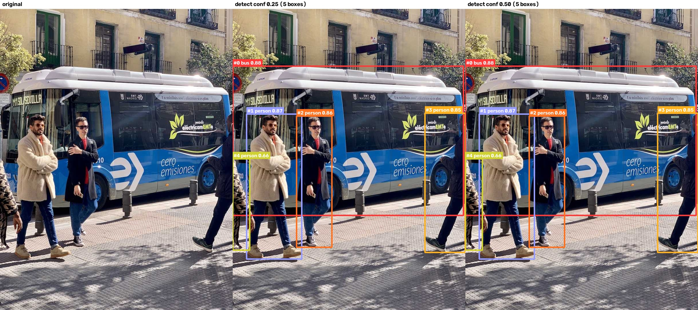
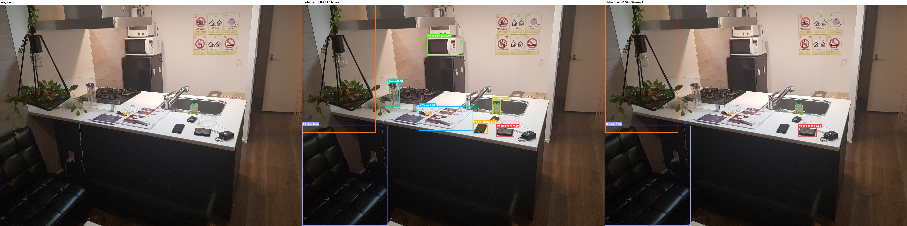
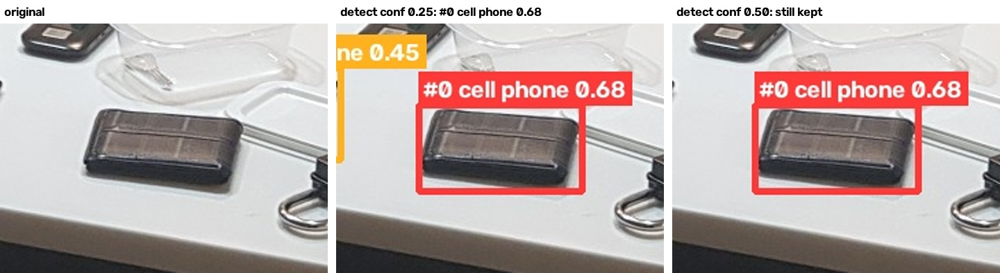
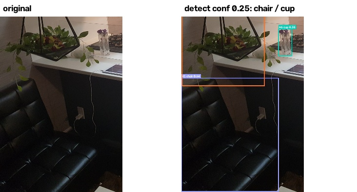
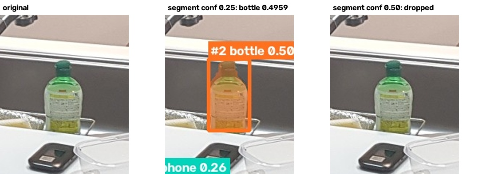
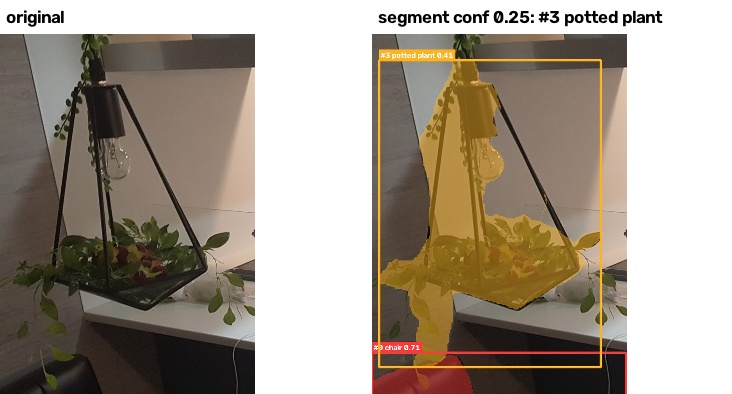

# YOLO 탐지·분할 서비스: 신뢰도 임계값 0.25 vs 0.50 비교

AIFFEL 03 모듈 4장 「AI가 문서와 사진에서 무엇을 꺼내는가」 선택 과제 A입니다.
사진을 넣으면 YOLO26으로 **탐지 박스**(클래스·점수·좌표)와 **분할 마스크**를 구합니다. 같은 사진을 신뢰도 임계값 **0.25와 0.50**으로 각각 돌려 비교하고, 결과 이미지·JSON·마스크·실행 기록을 파일로 남깁니다.



## 실행 방법

Windows PowerShell 기준입니다. GPU 없이 CPU만 씁니다.

```powershell
# 1) 가상환경 (Python 3.12)
uv venv --python 3.12 .venv          # 또는: py -3.12 -m venv .venv
.venv\Scripts\activate

# 2) 패키지: CPU용 PyTorch를 먼저, 나머지는 requirements.txt
pip install torch==2.15.0 torchvision==0.29.2 --index-url https://download.pytorch.org/whl/cpu
pip install -r requirements.txt

# 3) 실행 (모델 가중치 yolo26n.pt, yolo26n-seg.pt는 첫 실행 때 자동으로 내려받음)
python yolo_service.py input/bus.jpg input/kitchen.jpg
python findings.py                                       # README의 '발견한 것' 확대 그림을 다시 만든다

# 임계값 두 개를 바꿔 비교할 수도 있음 (findings.py의 설명 문구는 0.25/0.50 기준)
python yolo_service.py input/kitchen.jpg --conf 0.30 0.60
```

새 사진을 넣을 때는 `input/`에 두고, `input/sources.json`에 출처와 공유 조건을 한 줄 적은 뒤 실행합니다. 적지 않으면 manifest에 "미기록"으로 남습니다.

## 실행 환경과 설정

`outputs/yolo/manifest.json`에 실행 때마다 자동으로 기록됩니다.

| 항목 | 값 |
|---|---|
| 실행 위치 | 로컬 PC, Windows 11, CPU만 사용 |
| Python | 3.12.15 |
| 패키지 | ultralytics 8.4.208, torch 2.15.0+cpu, opencv-python 5.0.0.93, numpy 2.5.4 |
| 모델 | 탐지 `yolo26n.pt`, 분할 `yolo26n-seg.pt` (COCO 80개 클래스) |
| 설정 | `imgsz=640`, `device=cpu`, `conf=0.25`와 `0.50` |

## 결과 파일

```
outputs/yolo/
├─ manifest.json              입력 파일(sha256, 출처, 공유 조건), 모델 파일(sha256)·패키지 버전, 실행 위치, 설정, 요약
├─ code/yolo_service.py       실행한 코드 사본
└─ <사진 이름>/
   ├─ compare_detect.jpg      원본 | 탐지 conf 0.25 | 탐지 conf 0.50 나란히
   ├─ compare.json            0.25에서 있었고 0.50에서 사라진 박스 목록 (탐지·분할 각각)
   ├─ findings/               (kitchen만) 원본과 결과를 같은 위치에서 확대해 나란히 놓은 그림, findings.py가 만든다
   └─ conf0.25/, conf0.50/
      ├─ detect.jpg, detect.json     탐지 박스 그림과 클래스·점수·좌표
      ├─ segment.jpg, segment.json   마스크를 반투명으로 겹친 그림과 박스·마스크 정보
      └─ masks/<번호>_<클래스>.png   객체별 마스크 (원본 크기, 흰색 = 객체)
```

- 좌표 `xyxy`는 원본 픽셀 기준 `[왼쪽 x, 위 y, 오른쪽 x, 아래 y]`입니다. 그림의 `#번호`가 JSON의 `id`입니다.
- `segment.json`에는 객체마다 `mask_area_px`(마스크 넓이), `box_area_px`(박스 넓이), `background_in_box_ratio`(박스 안에서 마스크가 아닌 배경 비율)가 있습니다.
- 마스크 PNG는 저장한 뒤 **다시 열어** 저장 전과 같은지 확인하고, 결과를 `mask_reload_same`에 남깁니다.
- 탐지와 분할은 서로 다른 모델이라 같은 객체라도 `id` 순서와 점수가 다를 수 있습니다.

## 결과 요약 (자동 기록 값)

### 버스 예제 사진 (`input/bus.jpg`, 810×1080)

| 모델 | conf 0.25 | conf 0.50 | 0.50에서 사라진 박스 |
|---|---|---|---|
| 탐지 | 5개 (bus 1, person 4) | 5개 | 없음 |
| 분할 | 5개 (bus 1, person 4) | 5개 | 없음 |

탐지 박스 (conf 0.25, `outputs/yolo/bus/conf0.25/detect.json`):

| id | 클래스 | 점수 | 좌표 xyxy |
|---|---|---|---|
| 0 | bus | 0.88 | 0, 231, 803, 751 |
| 1 | person | 0.87 | 49, 398, 240, 902 |
| 2 | person | 0.86 | 223, 405, 346, 861 |
| 3 | person | 0.85 | 670, 395, 810, 879 |
| 4 | person | 0.66 | 0, 553, 60, 871 |

분할 마스크의 박스 안 배경 비율 (conf 0.25, `segment.json`): bus 0.38, person 0.41~0.69.

### 내 사진 (`input/kitchen.jpg`, 2016×1512)



| 모델 | conf 0.25 | conf 0.50 | 0.50에서 사라진 박스 |
|---|---|---|---|
| 탐지 | 8개 | 3개 | 5개 (#3~#7) |
| 분할 | 7개 | 2개 | 5개 (#2~#6) |

탐지 박스 (`outputs/yolo/kitchen/conf0.25/detect.json`, 0.50에서도 남은 것은 #0~#2):

| id | 클래스 | 점수 | 좌표 xyxy |
|---|---|---|---|
| 0 | cell phone | 0.68 | 1292, 853, 1411, 915 |
| 1 | chair | 0.64 | 0, 843, 571, 1510 |
| 2 | potted plant | 0.58 | 5, 0, 488, 887 |
| 3 | cell phone | 0.45 | 1143, 826, 1236, 893 |
| 4 | bottle | 0.41 | 1269, 670, 1323, 769 |
| 5 | microwave | 0.39 | 834, 250, 1072, 371 |
| 6 | cup | 0.38 | 572, 553, 649, 710 |
| 7 | book | 0.34 | 778, 715, 1138, 873 |

분할 박스 (`outputs/yolo/kitchen/conf0.25/segment.json`, 0.50에서도 남은 것은 #0~#1):

| id | 클래스 | 점수 | 박스 안 배경 비율 |
|---|---|---|---|
| 0 | chair | 0.71 | 0.35 |
| 1 | microwave | 0.67 | 0.04 |
| 2 | bottle | 0.50 (0.4959) | 0.21 |
| 3 | potted plant | 0.41 | 0.63 |
| 4 | refrigerator | 0.28 | 0.12 |
| 5 | cell phone | 0.27 | 0.14 |
| 6 | cell phone | 0.26 | 0.28 |

## 원본 대조에서 발견한 것

원본과 결과 그림(`outputs/yolo/kitchen/conf0.25/detect.jpg`, `segment.jpg`)을 나란히 놓고 박스마다 원본 위치를 확인했습니다. 정답 라벨은 없어서 판정은 눈으로 본 것입니다.

**내 사진 (부엌), 탐지 모델 conf 0.25**

| 박스 | 원본 위치에 실제로 있는 것 | 판정 |
|---|---|---|
| #0 cell phone 0.68 (1292, 853, 1411, 915) | **지갑** | **오탐(FP).** 이 사진에서 점수가 가장 높은 박스가 틀렸다. 그래서 0.50으로 올려도 걸러지지 않는다 |
| #1 chair 0.64 | 왼쪽 아래 검은 가죽 **소파** | **클래스 틀림.** 위치는 맞게 잡았지만 COCO에 `couch` 클래스가 따로 있는데 `chair`로 붙였다. 의자보다 조금 넓은 소파라 헷갈린 것으로 보인다 |
| #2 potted plant 0.58 | 걸이형 화분 | 맞음 |
| #3 cell phone 0.45 (1143, 826, 1236, 893) | 휴대폰 | 맞음. 0.50에서는 사라져 **미탐(FN)이 된다** |
| #4 bottle 0.41 | 싱크대 안의 병 | 맞음. 0.50에서 사라짐 |
| #5 microwave 0.39 | 전자레인지 | 맞음. 0.50에서 사라짐 |
| #6 cup 0.38 | 꽃을 꽂은 유리 **꽃병** | **클래스 틀림.** COCO에 `vase` 클래스가 있는데 `cup`으로 붙였다. 0.50에서 사라짐 |
| #7 book 0.34 | 조리대 위 안내 책자 | 맞음. 0.50에서 사라짐 |



#0의 JSON 좌표 `[1292, 853, 1411, 915]`를 원본에서 잘라 보면 지갑이다(위 그림 왼쪽). 0.50에서도 그대로 남는다(오른쪽).



**분할 모델 박스도 같은 방식으로 대조했다** (`segment.json`, conf 0.25)
- #0 chair 0.71 → 소파(클래스 틀림, 탐지 모델과 같은 실수)
- #1 microwave 0.67 → 전자레인지(맞음), #2 bottle 0.4959 → 싱크대 안의 병(맞음), #3 potted plant 0.41 → 화분(맞음), #4 refrigerator 0.28 → 소형 냉장고(맞음)
- #5 cell phone 0.27 (1293, 853, 1410, 914) → **지갑**(오탐, 탐지 모델 #0과 같은 자리), #6 cell phone 0.26 → 휴대폰(맞음)
- 분할 모델은 꽃병과 책자에는 박스를 그리지 않았다.

**박스가 없는 곳 (놓친 대상)**
- **토스터 오븐**(전자레인지 위), **싱크대**: COCO에 `toaster`·`oven`·`sink` 클래스가 있는데 두 모델 모두 박스가 없다. 0.25에서도 없으므로 임계값이 아니라 모델이 찾지 못한 것이다.
- **소형 냉장고**(전자레인지 아래 검은 상자): **분할 모델만** `refrigerator` 0.28로 찾았고 탐지 모델은 찾지 못했다. 0.50에서는 분할 결과에서도 사라진다. 같은 사진이라도 모델에 따라 찾는 대상이 다르다.
- 싱크대 오른쪽 위의 상자들은 분리수거통이다. COCO에 해당 클래스가 없어 박스가 없는 것이 맞다.

**임계값 0.50에서 일어난 일**
- 탐지: 8개 → 3개.
  - 남은 3개: #0 오탐(지갑), #1 클래스 틀림(소파), #2 맞음(화분). **완전히 맞은 것은 1개뿐**이다.
  - 사라진 5개: #3 휴대폰, #4 병, #5 전자레인지, #7 책자는 맞게 찾은 박스였고, #6은 클래스가 틀린 박스(꽃병)였다.
  - 0.50으로 올리자 높은 점수의 오탐·클래스 오류는 그대로 남고, 맞은 박스 4개가 사라졌다.


- 분할 #2 bottle은 점수가 **0.4959**로 0.50에 0.0041 모자라 0.50 결과에서 빠졌다. 신뢰도 임계값은 그 값 이상인 박스만 남기므로, 경계 바로 아래의 맞는 박스도 똑같이 사라진다.

**마스크 경계**



- 분할 #3 potted plant: 화분의 대부분을 덮었고 **가장자리 이파리 몇 장만 빠졌다.** 박스 안 배경 비율이 0.63으로 높은 이유는, 걸이 틀과 빈 공간까지 박스에 들어가서다.

**버스 예제 사진**
- 두 임계값 결과가 같았다(5개). 가장 낮은 점수가 0.66이라 0.25와 0.50 사이에 걸린 후보가 없었다. JSON 점수로 확인했다.

## 확인 필요 / 처리하지 못한 것

- **정답 라벨이 없다.** 그래서 IoU, 정밀도, 재현율, mAP는 계산하지 않았다. 위 판정은 원본을 눈으로 대조한 것이다.
- **태블릿**(조리대 왼쪽, 책자 옆): 박스가 없다. COCO 80개 클래스에 태블릿이 없어서(가까운 것은 `laptop`, `cell phone`), 놓친 것으로 셀지 판단하지 않았다.
- **전기 주전자**(전자레인지 위 오른쪽): 박스가 없다. COCO에 주전자 클래스가 없어 놓친 것으로 세지 않았다.
- **탐지 모델과 분할 모델의 같은 객체 짝짓기:** 두 모델의 `id` 순서가 달라 표에서는 위치와 클래스로 눈으로 맞췄다. 코드에서 자동으로 짝짓지는 않았다.
- 마스크 경계는 확대해서 눈으로만 봤다. 빠진 이파리가 몇 픽셀인지는 재지 않았다.
- 내 사진은 한 장뿐이라, 위 결과가 다른 부엌 사진에서도 같은지는 확인하지 못했다.

## 설정을 이렇게 고른 이유

| 설정 | 고른 이유 | 실제 결과와의 연결 |
|---|---|---|
| **로컬 PC, CPU만** (`device=cpu`) | 과제 요청문의 설정이고, GPU가 없는 사람도 같은 명령으로 다시 실행할 수 있어야 해서. 이 PC에는 GPU가 있지만 일부러 쓰지 않았다 | 사진 두 장 × 모델 두 개 × 임계값 두 개 전체가 CPU에서 약 4초 걸렸다(모델 내려받은 뒤 기준). 재실행에 GPU가 필요 없다 |
| **가장 작은 n 모델** (`yolo26n`, `yolo26n-seg`) | 노트북이 지정한 모델이고, CPU에서 가볍게 돌아간다 | 대부분의 물건을 찾았지만 점수가 0.3~0.7로 낮았고, 지갑을 휴대폰으로, 소파를 의자로, 꽃병을 컵으로 붙였다. 비슷하게 생긴 클래스끼리 헷갈리는 것은 작은 모델의 한계로 볼 수 있다(더 큰 모델과 비교하지는 않았다) |
| **탐지와 분할 두 모델** | 박스(위치)와 마스크(경계)를 같은 사진에서 비교하려고 | 냉장고는 분할 모델만 찾았다. 한 모델 결과만 보면 놓친 것을 알 수 없었다 |
| **conf 0.25 vs 0.50** | 과제가 지정한 두 값. 임계값을 올리면 무엇이 사라지는지 보려고 | 부엌 사진에서 0.50은 맞은 박스 4개를 버리고, 점수가 높았던 오탐(지갑)과 클래스 오류(소파)는 남겼다. 오탐을 줄이려고 임계값을 올리는 것이 이 사진에서는 효과가 없었다 |
| **`imgsz=640`** | 과제 요청문의 설정이며 YOLO 기본 입력 크기 | 좌표는 원본 픽셀로 돌려받아 JSON에 저장했다 |
| **결과를 JSON·PNG로 저장** | 화면에 그린 박스를 다른 프로그램도 읽을 수 있게 하고, 원본 위치로 돌아가 대조하려고 | 표의 좌표로 원본에서 지갑 위치를 바로 찾았다. 마스크 PNG는 다시 열어 저장 전과 같은지 확인했다(`mask_reload_same`) |

## 처음 예상과 실제

- **예상:** 잘 보이는 물건은 높은 점수로 찾을 것이다.
- **실제:** 대부분의 물건을 찾긴 했지만 점수는 생각보다 낮았다(0.3~0.7). 탐지 모델에서 가장 높은 점수(0.68)는 오히려 오탐(지갑)이었다. 그래서 점수만 보고 결과를 믿을 수 없고, 원본과 대조해야 한다는 것을 확인했다.

## 회고

모델이 대부분의 객체를 검출했지만 점수는 생각보다 낮게 나왔습니다.

YOLO를 활용한 과제는 정말 흥미롭고 재밌지만, 모델 개선과 데이터 정제 분야에서 두각을 드러내지 못해 그 분야로의 취업은 힘들어 보여 아쉽습니다. 헬스·건강류 앱은 음식 사진을 찍으면 다중 객체 검출 후 영양소를 분석해 주는데, 그 앱을 직접 만들어 보고 싶어서 만들어 보니 모델을 학습시키는 데 어려움을 겪었습니다. 하지만 시중에 있는 앱은 너무나 정확하게 검출을 하기에, YOLO 분야는 재미있지만 잘하지는 않는 취미의 영역으로 남았습니다.

## 입력 자료의 출처와 공유 조건

| 파일 | 출처 | 공유 조건 |
|---|---|---|
| `input/bus.jpg` | https://ultralytics.com/images/bus.jpg | Ultralytics 공식 예제 이미지. 4장 노트북이 과제 입력으로 지정한 사진 |
| `input/kitchen.jpg` | 본인이 직접 찍은 사진(2019-01, 숙소 부엌). 사람이 나오지 않는 사진을 골랐고, 공개용으로 EXIF(촬영 기기·시각)를 지우고 2016×1512로 줄인 사본 | 본인 촬영, 이 과제 저장소에 공개하는 데 동의 |

## 참고
- [Ultralytics 예측 모드](https://docs.ultralytics.com/modes/predict/), [모델 안내](https://docs.ultralytics.com/models/)
- Ultralytics 라이선스: [AGPL-3.0 / Enterprise](https://www.ultralytics.com/license)
